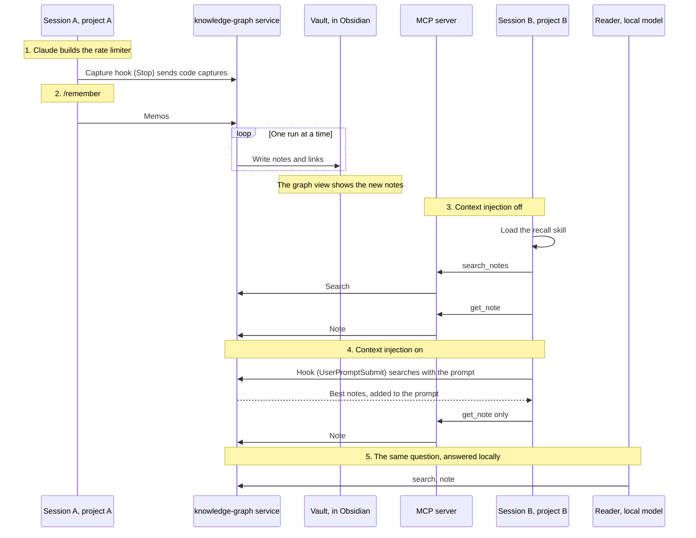

# Demo script

The live demo of knowledge-graph. Session A builds something in project A while the
graph grows in Obsidian, and `/remember` saves the decision behind it. Then
session B, in project B, asks about that work and gets an answer from project
A's notes: first with context injection off (the agent chooses to search the
graph), then on (the notes are already in its context), and last from the
Reader, a local model that answers with no cloud model at all.



**Success bar:** under ten minutes, and at least one question in project B
answered correctly, citing a note written during the demo. If live note-writing
fails, the seed vault still answers the [fallback question](#fallbacks).

| | Folder | What it is |
|-|--------|------------|
| Project A | `$DEMO_DIR/shortlinks` | A tiny dependency-free URL shortener. Its open todo: rate-limit `POST /links` |
| Project B | `$DEMO_DIR/notes-api` | A tiny dependency-free notes API, about to need the same rate limiting |
| Vault | `$DEMO_DIR/vault` | The demo vault, reset to the seed: 13 notes across shortlinks, notes-api and billing-service, with every kind of memo |

The kit lives in `demo/`:

| File | Does |
|------|------|
| `setup.sh <demo-dir> [--port N] [--force]` | Creates both projects (git repositories wired with the config from `examples/`: capture hook, MCP server, `/recall`, `/remember`), the vault, and `demo.env` |
| `reset.sh <vault> [--url URL]` | Puts the seed back in the vault and rebuilds the index (with `--url`, through the running service). Refuses any folder it didn't make |
| `injection.sh <project> on\|off [min-score]` | Adds or removes the context-injection hook entry in a project's `.claude/settings.json`; the threshold is 0.65 unless given |
| `service.sh <vault> [port]` | Runs the built service in the foreground against the local Ollama |
| `seed-vault/` | The seed notes, plus Obsidian graph colours per project |
| `projects/` | The two projects' starting code |

## Once, before the day (15 minutes)

1. Build knowledge-graph and pull the models:

   ```bash
   npm ci && npm run build
   ollama pull qwen3.5:9b && ollama pull bge-large
   ollama pull qwen3.6:35b-a3b-coding   # the Reader's model, for step 5 (22 GB)
   ```

2. Create the demo somewhere outside your real projects and vault, e.g.
   `~/knowledge-graph-demo`. Use port 5678 unless your own knowledge-graph service runs
   there; then pick another (`--port 5679`).

   ```bash
   demo/setup.sh ~/knowledge-graph-demo
   source ~/knowledge-graph-demo/demo.env
   ```

3. **Trust both projects in an interactive session.** Claude Code ignores a
   project's committed permission rules and MCP approval until the folder is
   trusted, and a live demo is interactive. For each project, with the service
   running (step 1 of [Before each run](#before-each-run-3-minutes)):

   ```bash
   cd "$DEMO_A" && claude      # then the same in "$DEMO_B"
   ```

   - Accept the trust dialog ("Yes, proceed"), and approve the `knowledge-graph`
     MCP server if asked.
   - `/mcp` shows `knowledge-graph` connected; `/hooks` shows the `Stop` hook (and
     in project B, after `demo/injection.sh "$DEMO_B" on`, `UserPromptSubmit`).
   - `/exit`.

4. Open `$DEMO_VAULT` in Obsidian as a vault ("Open folder as vault"), open
   the graph view and arrange the window. The seed's `.obsidian/graph.json`
   colours notes by project (shortlinks blue, notes-api orange,
   billing-service grey). Leave Obsidian open with the vault; `reset.sh`
   keeps its settings.

5. Rehearse once with the steps below.

## Before each run (3 minutes)

Lay out four windows: Obsidian's graph view, the service console, a terminal
in project A, a terminal in project B. `source ~/knowledge-graph-demo/demo.env` in
every terminal.

1. Start Ollama, then the service in its own terminal, and leave it visible:
   it prints one line per run.

   ```bash
   demo/service.sh "$DEMO_VAULT" 5678
   # knowledge-graph listening on 127.0.0.1:5678 ... index: 13 notes, ...
   ```

2. Reset the vault and switch context injection off in project B:

   ```bash
   demo/reset.sh "$DEMO_VAULT" --url "$KG_SERVICE_URL"
   # reset: ... holds the seed again (13 notes)
   # reindex complete: 13 notes, 13 embedded
   demo/injection.sh "$DEMO_B" off
   ```

   Run the reset before each run and never while a run is in progress. To
   reset the demo projects as well, `demo/setup.sh ~/knowledge-graph-demo --force`
   (then repeat the trust step, since the folders are new).

3. Warm the models so the first run isn't slow:

   ```bash
   curl -s localhost:11434/api/generate -d '{"model":"qwen3.5:9b","prompt":"hi","stream":false}' >/dev/null
   curl -s -X POST "$KG_SERVICE_URL/webhook/knowledge-graph/search" -H 'Content-Type: application/json' -d '{"query":"warm up"}' >/dev/null
   ```

## What runs where

For the question "is this all local?". The detail is in
[docs/architecture.md](../docs/architecture.md#what-runs-where).

| Part | Runs on |
|------|---------|
| Code capture (the capture hook) | Local script, no model |
| Documenter and Linker | Local: Ollama, `qwen3.5:9b` |
| Embeddings and search | Local: Ollama, `bge-large` |
| Context injection (the hook) | Local script |
| Memos (`/remember`) | **Claude** writes them; stored and linked locally |
| Session A's coding | **Claude** |
| Session B's answer | **Claude**, reading the graph through the local MCP server |
| Step 5's answer (the Reader) | Local: Ollama, `qwen3.6:35b-a3b-coding` |

The graph is built locally, except the memo text, which Claude writes because
only the session's agent has the conversation. Step 5 reads it with no cloud
model at all.

## The demo (about 8 minutes)

Times are from the rehearsal on real Ollama (qwen3.5:9b, bge-large); the
talking points fill the waits.

### 0. Set the scene (1 min)

Show the graph view: the seed is three projects' worth of notes. Open the
shortlinks todo "Add rate limiting to the shortlinks create-link endpoint
before launch". Today we do it in project A, then use what we learned in
project B.

### 1. Session A builds the rate limiter (about 45 s, then 45 s of captures)

In the project A terminal, `claude`, press Shift+Tab once for "accept
edits", and paste:

```text
Add rate limiting to POST /links. Put a token bucket in a new src/rate-limit.js and use it in src/server.js: each client IP gets a bucket of 5 tokens that refills at one token every 12 seconds, so 5 new links a minute with bursts of up to 5. When the bucket is empty, answer 429 with a Retry-After header in seconds. Keep the buckets in a Map and drop any that have been full for 10 minutes. We're choosing a token bucket over a fixed-window counter because a fixed window lets a client send twice the limit across a window boundary, and keying by IP because shortlinks has no API keys yet; no Redis, since it runs as one process with no dependencies. Keep it dependency-free and reply briefly.
```

Claude writes `src/rate-limit.js` and edits `src/server.js` (rehearsal: 44 s).
It may ask to run a quick check over HTTP: approve it (a few seconds), or
decline and `/remember` will save a todo to test it.

When the turn ends, the capture hook sends one code capture per file. Watch
the service console and the graph: `2026-10-27_shortlinks_src_rate-limit.js`
and `2026-10-27_shortlinks_src_server.js` appear about 25 s and 45 s later, linked to the
billing-service rate limiter and the shortlinks todo.

Talking point: the hook is async, so Claude never waits for it; captures run
one at a time in a queue so they don't fight over one local Ollama.

Talking point: Claude in the cloud wrote the code, but everything after the
turn ends is on this laptop. The capture hook is a script, the Documenter and
Linker run on Ollama, and the embeddings on bge-large.

### 2. `/remember` saves the decision (about 70 s)

In the same session:

```text
/remember
```

The agent writes the memos itself (it has the whole conversation), sends them,
and waits for the run, which queues behind the code captures (rehearsal: 70 s
in all, the memo run itself 25 s). It reports each memo's name, kind and
links. Rehearsal: a decision ("Rate-limit shortlinks POST /links with an
in-memory per-IP token bucket"), a todo (verify it end to end) and a snippet
(the check command), each linked under **Same Session** to the two code notes
and to the other two memos.
Open the decision memo in Obsidian: context paragraph, choice, rejected
alternatives, consequences.

Talking point: this is the one cloud step in building the graph. Claude writes
the memo because only it has the conversation; storing, linking and indexing
it are local.

`/exit`. Then, in the same terminal, start loading the Reader's model for
step 5 in the background. The captures are done, so it can't slow them, and
steps 3 and 4 don't use the service's chat model:

```bash
curl -s localhost:11434/api/generate -d '{"model":"qwen3.6:35b-a3b-coding","prompt":"hi","stream":false,"think":false}' >/dev/null &
```

### 3. Session B, context injection off: the agent chooses to search (about 30 s)

In the project B terminal, `claude`, and paste:

```text
Before I add rate limiting to POST /notes here: how did I rate-limit link creation in shortlinks, and why that approach? Don't change any files yet.
```

Expected (rehearsal: 30 s): Claude loads the `recall` skill on its own, calls
`search_notes`, opens the shortlinks decision memo, the new
`2026-10-27_shortlinks_src_server.js` code note and the todo with `get_note`, and
answers: a 5-token bucket refilling one every 12 s per client IP, 429 with
`Retry-After`, a Map swept after 10 minutes; token bucket because a fixed
window allows twice the limit across a boundary, IP because there are no API
keys, no Redis because it's one dependency-free process. It ends with
**Notes used**, citing notes written minutes ago in project A.

Talking point: nobody told it to use the graph; the skill's description says
when the graph is worth checking. Every claim cites its note.

Talking point: Claude writes the answer, but the graph it reads and the search
behind `search_notes` stay on this machine.

`/exit`.

### 4. Session B, context injection on: the notes are already there (about 35 s)

```bash
demo/injection.sh "$DEMO_B" on
claude
```

Paste the same prompt as step 3. The `UserPromptSubmit` hook searches the
graph with the prompt and adds the best three notes above 0.65 (rehearsal: the
shortlinks todo 0.80, the new decision memo 0.77, the new verify todo 0.77) as
a `<knowledge-graph-reference-notes>` block. Expected (rehearsal: 35 s): the agent
goes straight to `get_note` on the injected notes, with no `search_notes`
call, and gives the same cited answer, plus how it fits notes-api's code.
Press Ctrl+O to show the hook's added context in the transcript.

Talking point: for and against injection (examples/README.md): recall without
asking, at the price of tokens on every prompt and recall you don't see.

### 5. The same question, answered by a local model (about 20 s)

In the project B terminal:

```bash
node /ABSOLUTE/PATH/TO/knowledge-graph/dist/ask.js "Before I add rate limiting to POST /notes here: how did I rate-limit link creation in shortlinks, and why that approach?"
```

Expected (rehearsal: 14 s warm, 33 s if the model had to load): stderr shows
each step, typically one `search_notes` (with `kind: "decision"`), then
`get_note` on the new decision memo and its companion, then the answer; stdout
gives the same facts as step 3 (5-token bucket per IP, one token every 12 s,
429 with `Retry-After`, a Map swept after 10 minutes; token bucket over a
fixed window, IP for want of API keys, no Redis for one dependency-free
process), cited inline, ending in **Notes used**.

Talking point: nothing here leaves the machine. The Reader is a small tool
loop over Ollama's API with the same three tools as the MCP server; it
refuses a non-loopback URL or an Ollama cloud model, so the graph can hold
notes you'd never send to a cloud model. Pointing Claude Code itself at the
local model took 158 s and skipped the graph, which is why it's a
purpose-built loop.

### 6. Close (30 s)

Graph view: the new notes from project A, linked to the seed. One vault,
every project; the notes are plain markdown and the index rebuilds from them.
Nothing in the graph depends on the cloud: it's local markdown and a local
index, and any agent that can call the three graph tools can read it.

## Fallbacks

| If | Then |
|----|------|
| No code notes appear after step 1 | Check the service console. `/hooks` in session A should list the Stop hook; if the folder isn't trusted, repeat the trust step. Carry on: `/remember` still writes memos |
| `/remember` says the service isn't running | Start it (`demo/service.sh`) and `/remember` again |
| `/remember` exits 2 (still queued) | Captures are slow today; run the `--run <id>` command it printed |
| Session B doesn't use recall on its own | Ask explicitly: `/recall how did I rate-limit link creation in shortlinks, and why?` |
| `knowledge-graph` tools are denied or missing | `/mcp` and approve the server, or ask with `/recall …`, whose skill pre-approves the three tools |
| Live notes never arrived (Ollama down, runs failing) | Ask the **fallback question**, answered from the seed alone: `Before I add rate limiting to POST /notes here: how have I rate-limited APIs in my other projects, and why that approach? Don't change any files yet.` Rehearsal: cites the billing-service token-bucket decision and the fixed-window learning, and the open shortlinks todo |
| Injection adds nothing in step 4 | The agent searches instead and gives the same answer, so carry on. The causes: the service took over 1.5 s (cold embedding model), nothing cleared 0.65, or Claude Code cancelled the hook as timed out while the session was starting (seen once in three tries on a loaded machine, though the hook alone takes a quarter of a second). To show injection, rerun the warm-up, `/exit`, start `claude` again and ask again |
| In step 4 the agent still searches | Fine: show the injected block with Ctrl+O; the answer is the same |
| Step 5 says the model is not pulled | `ollama pull qwen3.6:35b-a3b-coding` after the demo; now, `KG_READER_MODEL=qwen3.5:9b` and ask again (about 30 s) |
| Step 5 takes over 30 s | The model is loading (22 GB): talk over it. The warm-up after step 2 avoids it |
| Step 5 says the service isn't reachable | `source demo.env` in that terminal, so `KG_SERVICE_URL` points at the demo's port |
| Anything else goes wrong | `demo/reset.sh "$DEMO_VAULT" --url "$KG_SERVICE_URL"` and run the fallback question |

## Known issues

- **Headless runs** (`claude -p`, as in the rehearsal) run in untrusted
  folders: pass `--permission-mode acceptEdits` in project A and
  `--allowedTools "Skill(recall)"` in project B, or recall the agent starts on
  its own is denied.
- **The memos file.** `/remember` writes its memos to the session's
  scratchpad; the capture hook ignores the scratchpad and any file outside the
  project (such as Claude's own memory files under `~/.claude/projects/`).

## Context-injection threshold

The default threshold (0.6) was measured on ten synthetic code notes. Against
the seed vault with bge-large, the best hit for each prompt scored:

| Prompt | Best hit | Score |
|--------|----------|-------|
| The step 3 and 4 question | shortlinks todo | 0.80 (0.77 for the decision memo once it exists) |
| How have I rate-limited APIs before? | billing-service decision | 0.73 |
| How do I check the notes data file is valid? | the jq snippet | 0.80 |
| Why do Stripe webhook signatures fail? | the Stripe learning | 0.82 |
| Add pagination to GET /notes | notes-api app note | 0.67 |
| Rename the PORT variable to NOTES_PORT | notes-api app note | 0.64 |
| What's still open in shortlinks? | shortlinks server note | 0.62 |
| Add a GET /health endpoint | Stripe learning (unrelated) | 0.55 |
| fix the typo in the README | jq snippet (unrelated) | 0.51 |
| thanks, looks good | jq snippet (unrelated) | 0.47 |

Unrelated prompts stay at or below 0.55, but routine prompts about project B
(0.61 to 0.64) would get loosely related notes at 0.6. The demo uses **0.65**:
the demo questions clear it with room to spare, and small talk and routine
edits add nothing. `demo/injection.sh` sets it; pass another value as its
third argument.

## Rehearsal log

2026-10-27, headless (`claude -p`, `--resume` for the second turn of session
A), the service on port 5693 against real Ollama (qwen3.5:9b, bge-large),
Researcher off.

| Step | Elapsed | Result |
|------|---------|--------|
| Reset and reindex | 2 s | 13 seed notes, 13 embedded |
| 1. Session A builds the limiter | 44 s | `src/rate-limit.js` written, `src/server.js` edited. Its HTTP check was denied (headless, untrusted) |
| Code captures | 26 s and 20 s, queued | `2026-10-27_src_rate-limit.js`, `2026-10-27_src_server.js`, linked to the billing-service and shortlinks seed notes. Nothing outside the project was captured |
| 2. `/remember` | 70 s (memo run 25 s) | 3 memos: decision, todo (verify the limiter), snippet; each linked to both code notes |
| 3. Session B, injection off | 30 s | `recall` skill, `search_notes`, `get_note` × 3; correct answer citing the new decision memo, the new `src/server.js` note and the new todo |
| 4. Session B, injection on | 28 s, then 35 s | First run: injected three notes, but the agent searched anyway; the recall skill now starts from injected notes. Second run: no `search_notes`, `get_note` on the injected notes; same correct, cited answer |
| Fallback question, seed only (after a reset) | 27 s | Correct answer citing the billing-service decision and learning, and the shortlinks todo |

Then the whole demo again in one go with the final kit, from `setup.sh --force`:

| Step | Started | Elapsed | Result |
|------|---------|---------|--------|
| Set-up, reset, injection off | 07:45:52 | 2 s | 13 seed notes |
| 1. Session A | 07:45:54 | 55 s | Limiter written; its checks denied (headless). Code captures took 23 s and 20 s |
| 2. `/remember` | 07:46:50 | 69 s | 3 memos (decision, two todos), each linked to both code notes; memo run 23 s |
| 3. Session B, injection off | 07:47:59 | 31 s | Searched, opened four new notes, correct answer citing the new decision memo and code note. It also spotted the Documenter's note giving the sweep as 10 s against the memo's 10 minutes, and said so |
| 4. Session B, injection on | 07:48:31 | 29 s | No search: opened the injected decision memo and todos; correct answer citing the new decision memo |

Machine time from reset to the end of step 4: **3 min 6 s**, which leaves
about six minutes for the talking points inside ten.

Again after the review fixes (project in note names, memos of one run
linked to each other, type and kind kept apart), headless, from `setup.sh`
on port 5694:

| Step | Started | Elapsed | Result |
|------|---------|---------|--------|
| Set-up, reset, injection off, warm-up | 08:21:15 | 19 s | 13 seed notes |
| 1. Session A | 08:21:42 | 42 s | Limiter written; its smoke test denied (headless). Code captures took 20 s and 19 s: `2026-10-27_shortlinks_src_rate-limit.js`, `2026-10-27_shortlinks_src_server.js` |
| 2. `/remember` | 08:23:06 | 62 s | 3 memos (decision, two todos), each linked under Same Session to both code notes and the other two memos, with no Related Notes repeating them; memo run 25 s |
| 3. Session B, injection off | 08:24:22 | 34 s | `recall` skill, two searches, `get_note` × 4; correct answer citing the new decision memo, the new `src/server.js` note and both new todos |
| 4. Session B, injection on | 08:25:06 | 34 s | Injected the shortlinks todo, the new decision memo and the new verify todo; no search, `get_note` on those; same correct, cited answer |

Machine time from reset to the end of step 4: **4 min 25 s**, warm-up included.

Again after search stopped waiting behind a run's indexing, headless, from
`setup.sh` on port 5695, on a busy machine (load average 13 over five
minutes). A probe ran the context-injection hook with the step 3 question once
a second through steps 1 and 2:

| Step | Started | Elapsed | Result |
|------|---------|---------|--------|
| Set-up, reset, injection off, warm-up | 16:34:22 | 7 s | 13 seed notes |
| 1. Session A | 16:35:01 | 46 s | Limiter written; its test run denied (headless). Code captures took 58 s and 41 s, slowed by the probe and the load (32 s for one capture alone afterwards) |
| 2. `/remember` | 16:35:56 | 159 s | 3 memos (decision, reverse-proxy todo, verify todo), each linked to the other two and both code notes; memo run 62 s. The command stopped waiting before the run finished, and the agent checked again with `--run`, as the skill says |
| Probe, during steps 1 and 2 | 16:35:01 | 87 calls | Every call injected three notes; 632 ms median, 1.5 s at worst, node start-up included. Project A's new code note was among them from 16:36:43, while later runs were still queued |
| 3. Session B, injection off | 16:39:04 | 32 s | `recall` skill, one search, `get_note` × 6; correct answer citing the new decision memo, both new code notes and both new todos |
| 4. Session B, injection on | 16:39:45 | 46 s | Claude Code cancelled the hook as timed out after 12 s at session start, so nothing was injected; the agent searched instead and gave the same correct, cited answer |
| 4, again | 16:41:38 | 33 s | Injected the shortlinks todo, the new decision memo and the new verify todo; no search, `get_note` on those; same answer |
| 4, a third time | 16:42:29 | 30 s | Injected the same three notes; no search; same answer |

Machine time from reset to the end of the first try at step 4: **6 min 9 s**.

The Reader, 2026-10-29, `npm run ask` against a copy of the vault after a
full run (project A's notes from 2026-10-28), on real Ollama
(`qwen3.6:35b-a3b-coding`, bge-large), service on port 5697:

| Question | Elapsed | Result |
|----------|---------|--------|
| The step 3 question, model not loaded | 32.7 s (first step 14.7 s, loading) | Two searches (the first with `kind: "memo"`, rejected as not a kind, so it retried with `type`), `get_note` × 2; correct answer citing the new decision memo and the IP-keying memo, the shortlinks todo and the X-Forwarded-For todo |
| The same, model loaded | 13.6 s | One search (`kind: "decision"`), `get_note` × 2; the same correct, cited answer |
| The fallback question | 18.7 s | One search, `get_note` × 4; correct answer citing the billing-service decision and fixed-window learning, the new shortlinks code note and the shortlinks todo |
