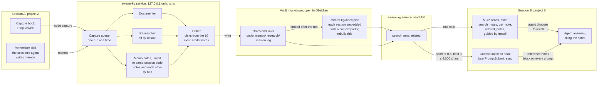

# Architecture

swarm-kg turns Claude Code sessions into a graph of linked markdown notes, and
lets an agent in any other session recall them. Everything runs on one
machine: Ollama, the service, the vault, the hooks and the MCP server.

**Two write paths.** The capture hook sends one code capture per file Claude
changed in a turn; the run's agents (Documenter, optionally Researcher, then
Linker) write it up as notes. A memo is written by the agent in the session
itself (a learning, decision, todo, snippet or conversation), so it carries
the reasoning, not just the diff; its run skips straight to linking.

**Two read paths.** Recall over MCP is the agent choosing to search, open a
note and walk its links. Context injection is recall done for it: every
prompt is searched and the few notes that clear the threshold are added.

## Trade-offs

| Decision | Chosen | Rejected | Why |
|----------|--------|----------|-----|
| Vault | Markdown vault as the seam ([ADR 0001](adr/0001-markdown-vault-is-the-seam.md)) | Graph or vector database | Notes stay readable and editable in Obsidian; a new source is just another note writer |
| Index | One rebuildable file in the vault, brute-force cosine | Vector database | Notes stay the only source of truth; a personal vault is hundreds to low thousands of notes |
| Chunks | Each `##` section embedded with title, type, kind, project and summary in front; a note scores as its best section | Whole-note embeddings | Long notes would be cut at the model's input limit, and "Key Points" alone matches nothing |
| Runs | One in-process queue, one run at a time | Parallel runs, a message broker | Parallel runs fight over one local Ollama and fail; a broker is overkill on one machine |
| Researcher | Off by default | Always on | The graph should hold my knowledge, not generic advice, and runs take about half the time |
| Who writes memos | The agent in the session | Ollama summarising the transcript | It has the whole conversation and is the strongest model available |
| Links | Same Session links by rule; the Linker chooses from the 10 most similar notes | The Linker reading every note name | Session links are certain, not guessed; candidates keep the Linker fast and accurate as the vault grows |
| Recall interface | stdio MCP server, a thin client of the service | An HTTP MCP server; agents reading vault files directly | No second network listener; the service stays the only owner of the index |
| Context injection | Synchronous hook, gives up after 1.5 s, off unless a project adds it | Async hook, on everywhere | Async context arrives one prompt late; extra tokens and invisible recall aren't worth it everywhere ([pros and cons](../examples/README.md#should-you-turn-it-on-for-a-project)) |
| Search | Embeddings only | Keyword or hybrid search | Enough for the POC; hybrid can come later |

## Safety

- **Loopback only.** There is no authentication, so the service binds to
  `127.0.0.1` by default and compose publishes its port on loopback only:
  nobody on the same wifi can send captures or read notes. The MCP server
  speaks stdio and has no listener at all.
- **Recalled notes are data, not instructions.** Notes can hold text from
  any captured file. Every MCP tool description and the `/recall` skill say so, and context
  injection wraps notes in a `<swarm-kg-reference-notes>` block that tells the
  agent not to follow them, with any copy of that tag inside a note escaped.
- **A size cap on injected text.** At most three notes and 4,000 characters
  per prompt, never more than 9,000.
- **No secrets in memos.** `/remember` leaves out credentials, tokens and
  personal data entirely; keeping them would need an encrypted vault and an
  authenticated service first.
- **The graph can't feed on itself.** The capture hook skips sessions working
  inside the vault, and every hook fails silent: always exit 0, short
  timeouts, nothing added if the service is down.

## Left out on purpose

A reader agent with its own loop, automatic capture before `/compact`, secrets
in memos and a dataset source are in [docs/ideas.md](ideas.md). Also out:
authentication, running anywhere but my machine, keyword search, and making
it installable by others. The read side was built so a second source needs
no change to it ([ADR 0001](adr/0001-markdown-vault-is-the-seam.md)).

## Where the build differs from the spec

- Sections over about 1,500 characters are split again at paragraph breaks,
  keeping their heading; session logs are left out of search as well as linking.
- Same Session links go to the session's code-capture notes and to the other
  memos sent in the same request, never to memos from earlier requests.
- Context injection skips prompts starting with `/`, so `/recall` does its
  own recall. The 0.6 threshold was measured with `bge-large`.
- `/remember` and `/recall` ship as example skills with the MCP config.
  `/remember` sends its memos through a file in the session's scratchpad and
  a small command (`dist/remember.js`) rather than an inline `curl`: Claude
  Code's Bash check refuses command text with a brace followed by a quote,
  which memo JSON always has. The capture hook skips scratchpad files, so that
  file is never a code capture.
